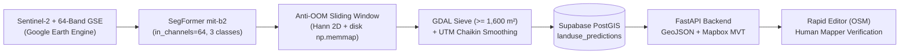

# LandAssist 🛰️🗺️

**AI-Assisted Landuse Segmentation & Vector Delivery System for OpenStreetMap Rapid Editor**  
*Target Release: v0.1.0 — Showcase 5 November 2026 (Pilot Area: Kabupaten Tangerang, Indonesia)*

[](#ci-cd--antigravity-sdk-automated-code-review)
[](#architecture-overview)
[-orange)](#ml--anti-oom-pipeline)

---

## Overview

**LandAssist** bridges 10-meter satellite earth observation and community-driven OpenStreetMap (OSM) mapping. Using **64-band Google Satellite Embeddings (GSE)** derived from Sentinel-2 Level-2A time-series imagery, LandAssist classifies **Industrial (`landuse=industrial`)** and **Residential (`landuse=residential`)** zones across **Kabupaten Tangerang** (~30 km × 30 km), converts raw raster predictions into clean, orthogonal/smoothed GIS polygons, and streams them directly into **Rapid Editor (`rapideditor.org`)** for human-in-the-loop verification.

> **Human-in-the-Loop Philosophy:** LandAssist never performs automated bulk imports into OpenStreetMap. Every AI-generated polygon is served as a reference/assistive layer in Rapid Editor so human mappers can inspect, refine, and approve each feature before uploading to OSM.

---

## Architecture Overview



### Core Pipeline Components

1. **64-Band Google Satellite Embeddings (`ml/src/model.py`, `ml/src/dataset.py`)**
   - Uses `transformers.SegformerForSemanticSegmentation` with `nvidia/mit-b2` adapted to accept **64 input channels** (`in_channels=64`) and output **3 classes** (`0: Background`, `1: Industrial`, `2: Residential`).
   - Trained with a combined **Focal Loss + Dice Loss** (`FocalDiceLoss`) and diagonal-flip / $90^\circ$ rotational augmentations (`RandomRot90AndFlip`) to handle class imbalance across Kabupaten Tangerang.
2. **Anti-OOM Sliding-Window Inference (`ml/src/infer_sliding.py`)**
   - Processes massive regional GeoTIFFs (`160x160` patches, `stride=80`, 50% overlap) using windowed `rasterio.windows.Window` reads and disk-backed `np.memmap` (`float16`) accumulators with a **2D Hann Window** to eliminate tile-boundary seams while keeping RAM strictly flat.
3. **Cartographic Post-Processing (`ml/src/vectorize.py`)**
   - Applies **GDAL `sieve`** (`threshold=16` pixels = $1,600\text{ m}^2$) to eliminate salt-and-pepper noise, reprojects into metric **UTM Zone 48S (`EPSG:32748`)** for **Chaikin Corner-Cutting** and Douglas-Peucker simplification (`5.0 m`), and reprojects back to valid **`EPSG:4326`** polygons.
4. **Multi-Version PostGIS Storage & FastAPI Delivery (`sql/001_init_postgis.sql`, `backend/app/`)**
   - Stores versioned geometries in Supabase PostgreSQL + PostGIS indexed with `GIST (geom)` and `BTREE (model_version, class_name)`.
   - Serves both **OSM-tagged GeoJSON (`GET /v1/landuse.geojson`)** and high-speed **Mapbox Vector Tiles (`GET /v1/tiles/{z}/{x}/{y}.pbf`)** via `ST_AsMVT`.

---

## Connecting LandAssist to Rapid Editor (`rapideditor.org`)

Mappers can load LandAssist predictions into [Rapid Editor](https://rapideditor.org) in under 30 seconds:

1. Open **[https://rapideditor.org/edit](https://rapideditor.org/edit)** and pan to **Kabupaten Tangerang** (e.g., Cikupa, Balaraja, Pasar Kemis, or Curug industrial corridors around `106.52, -6.20`).
2. Open the **Map Data** pane on the right sidebar (`Shortcut: U` or click the layers icon).
3. Under **Custom Data**, click **Add Custom Data URL** and paste either endpoint:
   - **Local Development / Offline Demo (`localhost:8000`):**
     ```text
     http://localhost:8000/v1/landuse.geojson?bbox={bbox}&version=v1.0.0
     ```
   - **Cloud Production Deployment (`<your-domain>` = Cloud Run / Railway / Render URL):**
     ```text
     https://<your-domain>/v1/landuse.geojson?bbox={bbox}&version=v1.0.0
     ```
   - **Mapbox Vector Tiles (MVT) Endpoint (High-Density Regional Rendering):**
     ```text
     http://localhost:8000/v1/tiles/{z}/{x}/{y}.pbf?version=v1.0.0
     ```
4. Each polygon automatically carries OpenStreetMap-compliant tags (`landuse=industrial` or `landuse=residential`, `source=LandAssist AI (Sentinel-2 GSE)`, `model_version=v1.0.0`) ready for mapper inspection and conversion.

---

## Multi-Pillar Versioning & Instant PostGIS Rollback

LandAssist enforces strict version traceability across five pillars:

| Pillar | Mechanism | Example |
| :--- | :--- | :--- |
| **1. Source Code** | Git SemVer Tags & Atomic Conventional Commits | `v0.1.0` |
| **2. ML Weights** | Hugging Face Hub Revision Tags | `anovvy/landassist-segformer-gse64@v1.0.0` |
| **3. Training Patches** | DVC / Immutable Manifest Checksums | `tangerang_gse64_2026Q3` |
| **4. PostGIS Predictions** | `model_version` column in `public.landuse_predictions` | `v1.0.0`, `v1.1.0-rc1` |
| **5. API Endpoints** | URL prefix `/v1/` + `?version=` query filter | `/v1/landuse.geojson?version=v1.0.0` |

### Zero-Downtime Rollback

When ingesting a new model run (e.g. `v1.1.0`), existing `v1.0.0` rows remain intact in `public.landuse_predictions`.
- **Canary Testing in Rapid Editor:** Append `?version=v1.1.0` to the Custom Data URL.
- **Instant Rollback:** If a newly promoted model exhibits regression, revert `DEFAULT_MODEL_VERSION=v1.0.0` in `.env` (or pass `?version=v1.0.0`) to restore previous predictions in **0 seconds** without re-running inference.

---

## Local Quickstart

### 1. Clone & Configure Environment

```bash
cp .env.example .env
# Edit .env with your DATABASE_URL if connecting to an external Supabase instance
```

### 2. Launch PostGIS + FastAPI via Docker Compose

```bash
docker compose up --build -d
```

- **FastAPI Docs (Swagger UI):** `http://localhost:8000/docs`
- **Health Check:** `http://localhost:8000/v1/health`
- **Sample GeoJSON Query (Kabupaten Tangerang):**
  ```bash
  curl "http://localhost:8000/v1/landuse.geojson?bbox=106.45,-6.30,106.60,-6.15&version=v1.0.0"
  ```

### 3. Run Linter & Automated Test Suite

```bash
pip install -r backend/requirements.txt
ruff check backend/ ml/src/ scripts/
pytest backend/tests/ -v
```

### 4. Run End-to-End GSE Download, ML Inference, Visual QA & PostGIS Ingestion

```bash
# 0. (Optional) Download 64-band GSE GeoTIFF for any target AOI via Earth Engine
python -m ml.src.download_gse \
  --bbox "106.45,-6.30,106.60,-6.15" \
  --year 2025 \
  --output data/tangerang_gse_64band.tif

# 1. Sliding-window inference with 2D Hann blending & disk memmap
python -m ml.src.infer_tangerang \
  --checkpoint weights/segformer-mitb2-gse64-v1.0.0.pt \
  --input-tif data/tangerang_gse_64band.tif \
  --temp-dir ./tmp_mmap

# 2. GDAL sieve (>= 1,600 m²) + UTM Zone 48S Chaikin smoothing + Interactive HTML Visual QA
python -m ml.src.vectorize \
  --prob-mmap ./tmp_mmap/pred_sum.mmap \
  --ref-tif data/tangerang_gse_64band.tif \
  --output outputs/tangerang_v1.0.0.geojson \
  --model-version v1.0.0 \
  --html-preview outputs/tangerang_v1.0.0_qa.html

# 3. Bulk PostGIS ingestion via GeoPandas + SQLAlchemy
python -m ml.src.ingest_postgis \
  --input outputs/tangerang_v1.0.0.geojson \
  --model-version v1.0.0
```

---

## Antigravity IDE Customizations & CI/CD Code Review

This repository is pre-configured for **Antigravity IDE, CLI, and Python SDK (`google-antigravity`)**:

- **`AGENTS.md`**: Workspace-wide geospatial, PostGIS indexing, ML 64-channel anti-OOM, and Git hygiene rules automatically loaded by Antigravity agents.
- **`.agents/hooks.json`**: Automated `lint-reminder` hook keeping code quality checks aligned.
- **`.agents/skills/`**:
  - `add-osm-landuse-class`: Step-by-step skill for adding new OSM landuse classes across ML, PostGIS, and FastAPI.
  - `regional-inference-ingest`: Operational playbook for running sliding-window inference and zero-downtime PostGIS ingestion for new regions.
- **`scripts/agy_code_review.py`**: Headless PR review script powered by `google-antigravity` in **Read-Only Mode**, executed automatically on every Pull Request via `.github/workflows/ci-review.yml`.
