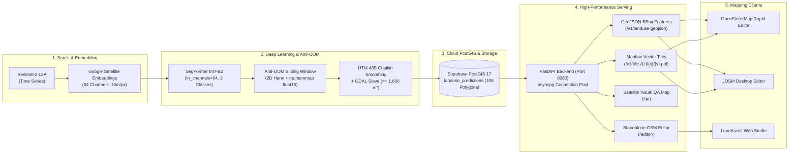

<p align="center">
  
</p>

# LandAssist 🛰️🗺️

**AI-Powered Earth Observation & Vector Delivery System for OpenStreetMap**  
*Showcase Edition: 5 November 2026 — Pilot Corridor: Kabupaten Tangerang, Banten, Indonesia*

[](https://github.com/Anovvy/LandAssist/actions/workflows/ci-review.yml)
[](https://github.com/Anovvy/LandAssist/actions/workflows/cd-deploy.yml)
[](https://python.org)
[](https://fastapi.tiangolo.com)
[](https://postgis.net)
[-orange.svg)](https://huggingface.co/nvidia/mit-b2)
[](LICENSE)

---

## 📌 Executive Overview

**LandAssist** adalah platform Earth Observation dan Computer Vision mutakhir yang menjembatani citra satelit resolusi 10 meter dengan komunitas pemetaan **OpenStreetMap (OSM)**. 

Menggunakan representasi citra satelit **64-Band Google Satellite Embeddings (GSE)** dari Sentinel-2 Level-2A, LandAssist secara otomatis mendeteksi dan mengklasifikasikan zonasi **Kawasan Industri (`landuse=industrial`)** dan **Pemukiman (`landuse=residential`)** di koridor strategis **Kabupaten Tangerang** (Cikupa, Balaraja, Pasar Kemis, Curug). Poligon hasil inferensi dihaluskan secara kartografis dan disajikan secara real-time ke web mapping editor untuk validasi human-in-the-loop.

> 🤝 **Filosofi Human-in-the-Loop:**  
> LandAssist menolak impor massal tanpa pengawasan (*no automated bulk import*). Setiap poligon yang dihasilkan AI disajikan sebagai kandidat layer assistif. Mapper manusia memiliki kendali penuh untuk meninjau, mengoreksi, dan menyetujui setiap geometri melalui aksi **`+ Add This Feature to OSM`** sebelum disimpan ke database OpenStreetMap global.

---

## 🏗️ Arsitektur Sistem End-to-End



---

## 🌟 Fitur Utama & Keunggulan Rekayasa

| Komponen | Spesifikasi Teknis & Fitur Unggulan |
| :--- | :--- |
| **Multichannel SegFormer** | Adaptasi backbone `nvidia/mit-b2` untuk menerima 64 channel input (`patch_embed[0].proj` berskala $3.0/64.0$) dengan `WeightedCEDiceLoss` (bobot industri 3.5×). Evaluasi: **Test mIoU 70.86%** (Industrial 62.82%, Residential 71.56%). Checkpoint: `weight/segformer-mitb2-gse64-v1.0.0.pt` (105.22 MB). |
| **Anti-OOM Sliding Window** | Inferensi raster raksasa skala kabupaten menggunakan *sliding window* dengan pembobotan **2D Hann Window** pada area overlap $50\%$ dan disk-backed `float16 np.memmap`, mengeliminasi *seamline artifacts* dan menjamin RAM stabil. |
| **Vektorisasi Standar OSM** | Filter luas minimum $1,600\text{ m}^2$ (16 piksel Sentinel-2 10m). Penghalusan sudut geometri menggunakan algoritma **Chaikin's Corner Cutting** pada proyeksi metrik **UTM Zone 48S (`EPSG:32748`)** sebelum direproyeksi ke **`EPSG:4326`**. Menghasilkan **106 poligon valid** (1,294 Ha). |
| **Supabase PostGIS 17** | Penyimpanan spasial cloud region Tokyo (`aws-0-ap-northeast-1`) dengan spatial index `GIST (geom)` dan composite index `(model_version, landuse_class)`. Server-side tile generation via `ST_AsMVT` dengan latensi di bawah 50 ms. |
| **Dual-Event CI/CD & AI Review** | Pipeline GitHub Actions yang memvalidasi Ruff linting dan Pytest unit test. Terintegrasi dengan **Antigravity SDK Automated Code Review** berbasis Google Gemini AI yang mengaudit git diff secara otomatis pada *Pull Request* maupun *direct push*. |
| **Monorepo Built-in Editor** | Frontend OpenStreetMap Web Editor disajikan langsung di bawah route `/editor/`, terbebas dari restriksi katalog pihak ketiga, dengan tombol aksi **`+ Add This Feature to OSM`**. |

---

## 📂 Struktur Repositori

```text
LandAssist/
├── backend/                  # Layanan API Spasial FastAPI
│   ├── app/
│   │   ├── main.py           # Entrypoint FastAPI, CORS, & static mount (/editor)
│   │   ├── config.py         # Pydantic Settings & environment loader
│   │   ├── db.py             # asyncpg connection pool & spatial queries
│   │   └── routers/          # geojson.py, tiles.py, health.py
│   ├── tests/                # 7 Unit tests Pytest (100% passing)
│   └── Dockerfile            # Container multi-stage image (Cloud Run & GHCR)
├── ml/                       # Machine Learning & Geospatial Pipeline
│   ├── src/
│   │   ├── model.py          # SegFormer 64-channel model architecture & loss
│   │   ├── download_gse.py   # Ingestion mosaik citra 64-band via Earth Engine
│   │   ├── infer_tangerang.py# Anti-OOM sliding window inference (Hann window)
│   │   ├── vectorize.py      # Chaikin polygon smoothing & QA HTML generator
│   │   └── ingest_postgis.py # High-performance asyncpg PostGIS ingestion
│   └── notebooks/            # Notebook pelatihan SegFormer Colab T4
├── frontend/                 # Standalone LandAssist Web Editor
│   └── dist/                 # Production compiled Rapid/iD editor bundle
├── docs/                     # Dokumentasi & aset grafis
│   └── assets/               # Logo resmi LandAssist
├── outputs/                  # Artefak GeoJSON Tangerang & Satellite QA HTML
├── scripts/                  # Utilities (test_db_connection.py, agy_code_review.py)
├── sql/                      # DDL schema PostGIS (001_init_postgis.sql)
├── weight/                   # Model weights manifest & release manager
├── .github/workflows/        # ci-review.yml & cd-deploy.yml
├── .env.example              # Blueprint konfigurasi secrets
└── pyproject.toml            # Ruff, Pytest, & packaging configuration
```

---

## ⚡ Panduan Memulai Cepat (Local Development)

### 1. Prasyarat Sistem
- Python 3.11 atau 3.12
- Node.js v20+ (untuk pengembangan frontend)
- Git & Git LFS

### 2. Kloning & Setup Lingkungan Virtual
```bash
git clone https://github.com/Anovvy/LandAssist.git
cd LandAssist

# Buat virtual environment
python -m venv .venv

# Aktivasi virtual environment
# Windows (PowerShell):
.venv\Scripts\Activate.ps1
# Linux/macOS:
source .venv/bin/activate

# Install dependensi backend & testing
pip install -r backend/requirements.txt
```

### 3. Konfigurasi Variabel Lingkungan
Salin file `.env.example` ke `.env` dan lengkapi kredensial Anda:
```bash
cp .env.example .env
```
Isi konfigurasi penting:
```ini
DATABASE_URL=postgresql://postgres.<ref>:<password>@aws-0-ap-northeast-1.pooler.supabase.com:5432/postgres
DEFAULT_MODEL_VERSION=v1.0.0
ALLOWED_ORIGINS=*
PORT=8080
```

Verifikasi koneksi database PostGIS:
```bash
python scripts/test_db_connection.py
```

### 4. Menjalankan Server API & Editor
```bash
# Set PYTHONPATH ke folder backend
$env:PYTHONPATH="backend"   # Windows PowerShell
# export PYTHONPATH="backend" # Linux/macOS

# Jalankan server FastAPI
python -m uvicorn app.main:app --host 127.0.0.1 --port 8080 --reload
```

Kunjungi layanan di peramban web:
- **Interactive OpenAPI Docs**: [http://127.0.0.1:8080/docs](http://127.0.0.1:8080/docs)
- **Visual Satellite QA Map**: [http://127.0.0.1:8080/qa](http://127.0.0.1:8080/qa)
- **LandAssist Web Editor**: [http://127.0.0.1:8080/editor/#map=15.00/-6.1850/106.5200](http://127.0.0.1:8080/editor/#map=15.00/-6.1850/106.5200)

---

## 🧪 Pengujian & Standar Mutu Kode

Setiap perubahan kode wajib lolos gerbang verifikasi lokal dan CI remote:

```bash
# 1. Menjalankan Ruff Linter
ruff check backend/ ml/src/ scripts/

# 2. Menjalankan Pytest Unit Test Suite
pytest backend/tests/ -v
```

Hasil Pengujian:
```text
backend/tests/test_api.py::test_healthz_returns_200_and_version PASSED      [ 14%]
backend/tests/test_api.py::test_get_versions_returns_available_model_versions PASSED [ 28%]
backend/tests/test_api.py::test_landuse_geojson_returns_valid_osm_feature_collection PASSED [ 42%]
backend/tests/test_api.py::test_landuse_geojson_bbox_and_class_filtering PASSED [ 57%]
backend/tests/test_api.py::test_landuse_geojson_invalid_bbox_returns_400 PASSED [ 71%]
backend/tests/test_api.py::test_cors_headers_for_rapid_editor PASSED        [ 85%]
backend/tests/test_api.py::test_mvt_tile_endpoint PASSED                    [100%]
============================== 7 passed in 1.45s ==============================
```

---

## 🗺️ Integrasi OpenStreetMap Rapid Editor

Poligon hasil inferensi LandAssist dapat dimuat ke dalam editor OpenStreetMap resmi:

### Opsi A: Menggunakan LandAssist Built-in Web Editor
1. Buka peramban ke [http://127.0.0.1:8080/editor/#map=15.00/-6.1850/106.5200](http://127.0.0.1:8080/editor/#map=15.00/-6.1850/106.5200).
2. Tekan tombol **`F`** (Map Data) $\rightarrow$ pada **Custom Map Data**, masukkan `http://127.0.0.1:8080/v1/landuse.geojson`.
3. Klik poligon target di peta $\rightarrow$ klik tombol **`+ Add This Feature to OSM`** di sidebar kiri.

### Opsi B: Menggunakan Rapid Editor Publik (`rapideditor.org`)
1. Buka [https://rapideditor.org/edit](https://rapideditor.org/edit) dan arahkan peta ke Kabupaten Tangerang (`106.52, -6.18`).
2. Tekan tombol **`F`** $\rightarrow$ buka **Custom Data** $\rightarrow$ masukkan endpoint publik:
   ```text
   https://<domain-kamu>/v1/landuse.geojson?bbox={bbox}
   ```
3. Poligon muncul sebagai layer referensi aktif siap dikonversi ke fitur OSM.

---

## 🔒 Tata Kelola Versi & Rollback Spasial

| Pilar | Mekanisme Versioning | Identifier Aktif |
| :--- | :--- | :--- |
| **Source Code** | Git Semantic Tagging & Conventional Commits | `v0.1.0` |
| **Model Weights** | Checksum SHA-256 + Manifest Registry | `segformer-mitb2-gse64-v1.0.0.pt` |
| **PostGIS Data** | Kolom partisi `model_version` pada tabel spasial | `v1.0.0` (106 baris data live) |
| **API Endpoints** | Prefix `/v1/` dengan parameter `?version=v1.0.0` | Zero-downtime instant rollback |

---

## 📜 Lisensi & Atribusi
Proyek ini dilisensikan di bawah lisensi **MIT License**.  
Data citra satelit dan embeddings bersumber dari **European Space Agency (ESA) Sentinel-2** dan **Google Satellite Embeddings (GSE)** melalui Google Earth Engine. Data peta dasar berhak cipta oleh para kontributor **OpenStreetMap** (ODbL).
