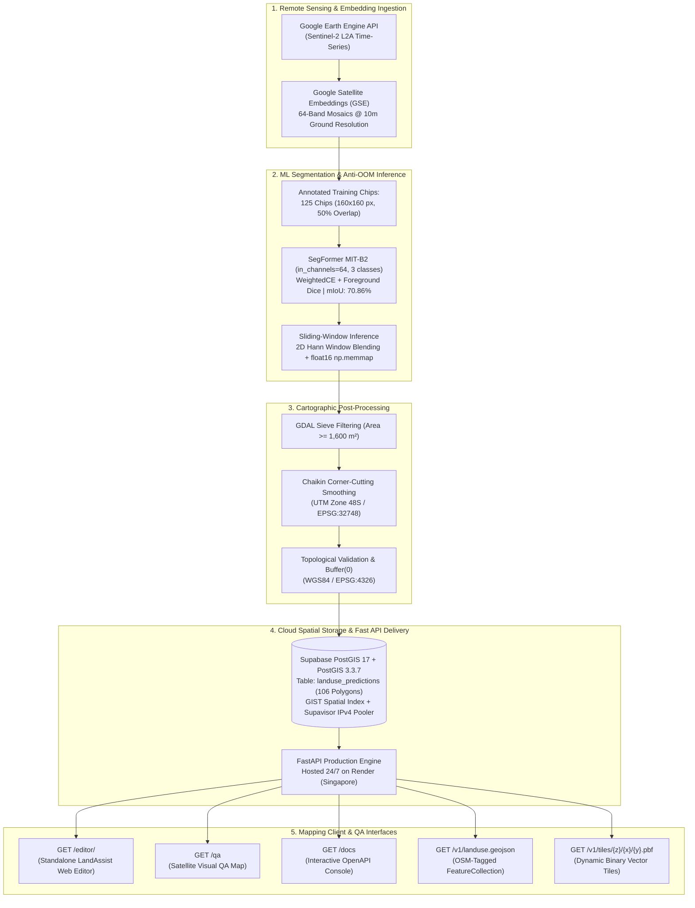

<p align="center">
  
</p>

<h1 align="center">LandAssist</h1>

<p align="center">
  <strong>AI-Assisted Earth Observation & Vector Delivery System for OpenStreetMap Web Editor</strong><br>
  <em>Production Release: v0.1.0 — Pilot AOI: Kabupaten Tangerang, Banten, Indonesia</em>
</p>

<p align="center">
  <a href="https://landassist-api.onrender.com/editor/"></a>
  <a href="https://landassist-api.onrender.com/docs"></a>
  <a href="https://github.com/Anovvy/LandAssist/actions/workflows/ci-review.yml"></a>
  <a href="https://github.com/Anovvy/LandAssist/actions/workflows/cd-deploy.yml"></a>
  <a href="https://postgis.net/"></a>
  <a href="https://huggingface.co/docs/transformers/model_doc/segformer"></a>
  <a href="https://www.openstreetmap.org"></a>
</p>

---

## Direct Access: Live Cloud Services

LandAssist is deployed 24/7 on high-availability cloud infrastructure (Singapore Region) backed by Supabase PostGIS spatial clusters. Live cloud endpoints and interactive interfaces:

| Service | Access Link | Description |
| :--- | :--- | :--- |
| **LandAssist Web Editor** | **[Launch Web Editor](https://landassist-api.onrender.com/editor/#map=14.50/-6.2200/106.5000)** | Standalone browser-based OpenStreetMap studio centered on Kabupaten Tangerang with active AI layers & changeset staging. |
| **Visual Satellite QA Viewer** | **[Open Visual QA Map](https://landassist-api.onrender.com/qa)** | Fullscreen Leaflet viewer with high-resolution Google Satellite imagery and vector overlay inspections. |
| **Interactive API Documentation** | **[Open Swagger / OpenAPI](https://landassist-api.onrender.com/docs)** | Interactive Swagger UI console to query and test spatial endpoints directly from your browser. |
| **Live GeoJSON Spatial Stream** | **[GET /v1/landuse.geojson](https://landassist-api.onrender.com/v1/landuse.geojson)** | Production FeatureCollection with OSM-compliant tags ready for GIS and web map clients. |
| **System & Database Health Probe** | **[GET /healthz](https://landassist-api.onrender.com/healthz)** | Real-time liveness and database connection status probe (`status: ok`, model: `v1.0.0`). |

---

## Executive Overview

**LandAssist** bridges 10-meter satellite Earth Observation and community-driven OpenStreetMap (OSM) mapping. Utilizing **64-channel Google Satellite Embeddings (GSE)** synthesized from Sentinel-2 Level-2A time-series multispectral imagery, LandAssist classifies **Industrial (`landuse=industrial`)** and **Residential (`landuse=residential`)** parcels across **Kabupaten Tangerang, Indonesia** (~30 km × 30 km AOI).

Raw raster predictions are converted into cartographically clean, topology-validated GIS polygons and streamed directly into **LandAssist Web Editor** (built-in standalone OSM web editor at `/editor`) for human-in-the-loop verification.

> [!IMPORTANT]
> **Human-in-the-Loop Philosophy:** LandAssist strictly rejects automated bulk imports into OpenStreetMap. Every AI-generated polygon is served as an assistive reference layer in **LandAssist Web Editor**, empowering human mappers to review, edit, and approve each boundary before committing changesets to the global OSM database.

---

## How to Use LandAssist Web Editor

The **LandAssist Web Editor** is an interactive, browser-based OpenStreetMap editing studio powered by a customized iD / Rapid open-source mapping engine.

### Step 1: Open the Live Editor
Visit **[https://landassist-api.onrender.com/editor/](https://landassist-api.onrender.com/editor/#map=14.50/-6.2200/106.5000)**. The map automatically loads the high-resolution satellite imagery basemap centered on Kabupaten Tangerang (`106.50, -6.22` at zoom level 14.5) with full regional **v1.1.0** AI predictions (2,460 parcels) pre-loaded.

### Step 2: Explore AI Landuse Layers
In the top toolbar, click the **LandAssist (AI Assist)** button:
- Toggle **Landuse Predictions (SegFormer AI)** on or off.
- Visual inspection legends:
  - **Industrial Area**: Rendered with **Gold Amber (`#F59E0B`)** high-visibility boundaries.
  - **Residential Area**: Rendered with **Emerald Green (`#10B981`)** boundaries.
- Click **Focus AOI (Kabupaten Tangerang)** anytime to re-center the canvas on the pilot corridor.

### Step 3: Inspect & Stage Features into OpenStreetMap
1. **Click any AI Polygon** on the map to open the **LandAssist AI Inspector card** on the left sidebar:
   - Review **Model Confidence** (e.g., `94.2%`), **Surface Area** (e.g., `12.4 Ha / 124,000 m²`), and Sentinel-2 acquisition metadata.
2. Click **`+ Add This Feature to OSM`**:
   - The AI overlay polygon is immediately converted into native OpenStreetMap entities (`osmWay` and `osmNode` vertices).
   - Appropriate OSM preset tags are automatically injected:
     ```text
     landuse = industrial   (or residential)
     source = LandAssist AI (Sentinel-2 GSE)
     source:date = 2026-11
     model_version = v1.1.0
     ```
   - The polygon dynamically assumes native iD editor preset styling (amber for residential, purple for industrial).
   - The edit is committed to the local history stack, and the top-right **Save** button counter immediately increments (`1`, `2`, ...).
3. If an AI detection is inaccurate, click **`- Ignore Feature`** to dismiss it from your mapping session.

### Step 4: Commit Changeset to OpenStreetMap
Click the top-right **Save** button to open the standard OSM Changeset panel:
- Review the summary of added ways and nodes.
- Enter your changeset comment (e.g., `Mapped industrial parcels in Tangerang using LandAssist AI`).
- Click **Upload** to commit directly to OpenStreetMap via OAuth 2.0.

---

## End-to-End System Architecture



---

## Key Technical Highlights

### 1. 64-Band Google Satellite Embeddings (GSE)
- Uses **64-channel deep embeddings** capturing seasonal phenology, surface texture, and multispectral reflectance rather than simple 3-band RGB imagery.
- Adapts `transformers.SegformerForSemanticSegmentation` (`nvidia/mit-b2`) with a customized stage-0 patch embedding projection layer accepting `in_channels=64` with weight variance preservation.
- Trained on **125 human-annotated chips** across Kabupaten Tangerang using **WeightedCE + Multiclass Foreground Dice Loss** with dihedral D4 geometric augmentations.
- Evaluated on test set: **Test mIoU 0.7086** (FG-mIoU 0.6719, IoU Industrial 0.6282).
- Checkpoint registered in [`weight/manifest.json`](weight/manifest.json) with SHA-256 integrity verification (`704e6e66...`).

### 2. Anti-OOM Sliding-Window Inference Engine
- Reads regional rasters via windowed chunks (`rasterio.windows.Window`, tile size 160, overlap 80).
- Blends boundaries using a **2D Hann Window** (`min_weight=0.05`) to completely eliminate tile-boundary seams.
- Accumulates probabilities into disk-backed `float16 np.memmap` arrays, keeping runtime RAM strictly under 2.5 GB even on massive multi-gigabyte rasters.

### 3. Cartographic Polygonization & Smoothing
- **GDAL Sieve**: Removes salt-and-pepper artifacts smaller than 16 pixels ($1,600\text{ m}^2$, matching typical residential plot clusters).
- **Chaikin Corner Cutting**: Executes metric boundary smoothing in **UTM Zone 48S (`EPSG:32748`)** followed by Douglas-Peucker simplification ($4.0\text{ m}$ tolerance) and small interior hole removal ($< 2,500\text{ m}^2$).
- **EPSG:4326 Re-projection**: Validates all geometries (`geom.buffer(0)` / `shapely.make_valid`) to guarantee zero self-intersections.

### 4. Enterprise Spatial API & Supabase PostGIS 17
- Connects to **Supabase PostGIS 17 + PostGIS 3.3.7** via `asyncpg` with **Supavisor Transaction Pooler support (`port 6543`, IPv4)** and `statement_cache_size=0`.
- Fast spatial queries powered by **GIST 2D indexing** (`idx_landuse_predictions_geom`).
- Employs **Dual-Mode Graceful Degradation**: If `DATABASE_URL` is omitted or temporarily unreachable, the API seamlessly falls back to an in-memory cached GeoJSON dataset with zero downtime.

---

## Project Limitations & Scope

To ensure transparent application and scientific rigor, the operational boundaries and technical constraints of LandAssist are outlined below:

### 1. Spatial Resolution and Object Scale (10m GSD)
- LandAssist utilizes 64-channel Google Satellite Embeddings derived from Sentinel-2 Level-2A multispectral imagery at a 10-meter ground sampling distance (1 pixel = 100 m²).
- The pipeline is designed for macro- and meso-scale land-use zoning (`landuse=residential` and `landuse=industrial`), not for micro-scale individual building footprint extraction (`building=yes`) or narrow pedestrian corridors (< 10m).

### 2. Semantic Class Granularity (Dual-Class Focus)
- The model (v1.0.0) is trained specifically to distinguish between industrial complexes and residential clusters against background terrain.
- Mixed-use zones (e.g., commercial shophouses along major transit arteries), dedicated commercial centers, agricultural land (paddy fields), and coastal aquaculture ponds are currently grouped into the background class. Future model iterations will expand to additional OpenStreetMap land-use categories.

### 3. Geographic Generalization and Spatial Transferability
- Ground-truth training data (125 chips) is localized to the industrial-residential corridor of Kabupaten Tangerang, Banten (~30 km × 30 km).
- While the model exhibits high fidelity on West Java suburban morphology and roofing profiles (corrugated metal, zinc, red tile), running direct inference on topographically dissimilar terrains (e.g., mountainous highlands or arid regions) without local fine-tuning may experience domain shift and reduced precision.

### 4. Cartographic Boundary Characteristics
- Vectorization incorporates GDAL sieve filtering with a Minimum Mapping Unit (MMU) of 16 pixels (1,600 m²) and two iterations of Chaikin corner-cutting smoothing.
- Resulting vector boundaries possess smooth, organic cartographic curvature rather than sharp 90-degree cadastral lot angles. Mappers should treat boundaries as generalized parcel zones rather than legal cadastral property lines.

### 5. Satellite Temporal Compositing
- Remote sensing inputs rely on seasonal cloud-free composite mosaics aggregated in Google Earth Engine.
- Very recent land-cover transitions (such as ground clearing or construction initiated within the last few weeks) may not be immediately reflected until subsequent composite mosaic updates are processed.

---

## Production API Reference

Base URL: `https://landassist-api.onrender.com`

| Endpoint | Method | Response Type | Description |
| :--- | :---: | :--- | :--- |
| **`/editor/`** | `GET` | `text/html` | Standalone LandAssist Web Editor mapping studio. |
| **`/qa`** | `GET` | `text/html` | Leaflet Satellite Visual QA inspection dashboard. |
| **`/docs`** | `GET` | `text/html` | Interactive Swagger / OpenAPI documentation. |
| **`/healthz`** | `GET` | `application/json` | Health status probe, version, and active DB mode. |
| **`/v1/versions`** | `GET` | `application/json` | Inventory of available model versions for instant rollback. |
| **`/v1/landuse.geojson`** | `GET` | `application/geo+json` | OSM-compliant GeoJSON FeatureCollection with optional `bbox` and `class_name` filters. |
| **`/v1/tiles/{z}/{x}/{y}.pbf`** | `GET` | `application/vnd.mapbox-vector-tile` | Dynamic Mapbox Vector Tiles generated via PostGIS `ST_TileEnvelope`. |

---

## Automated Testing & Quality Gate

LandAssist maintains an automated CI/CD pipeline ensuring 100% test pass rate and clean code quality:

- **17 Automated Unit Tests (100% Pass Rate)**:
  - **FastAPI Backend (8 tests)**: Health probe, model version inventory, GeoJSON validation, spatial bounding-box filtering, invalid bbox handling, CORS headers, MVT endpoints, and `/editor/` mount.
  - **ML Pipeline (9 tests)**: 64-channel SegFormer instantiation, WeightedCE Dice loss, 2D Hann window, grid generation, Chaikin smoothing, polygon simplification, probability map vectorization, MultiPolygon promotion, and checkpoint resolution.
- **Ruff Code Linter**: Clean (0 errors / 0 warnings across all Python modules).
- **Automated Antigravity AI Review**: Evaluates every PR against strict spatial and security rules using Google Gemini 2.5 Flash.

---

## Multi-Pillar Versioning & Zero-Downtime Rollback

LandAssist enforces end-to-end traceability across 5 pillars:

| Pillar | Governance Mechanism | Active Pilot Value |
| :--- | :--- | :--- |
| **1. Source Code** | Git Semantic Versioning Tags | `v0.1.0` |
| **2. Model Weights** | SHA-256 Digest in `weight/manifest.json` | `segformer-mitb2-gse64-v1.0.0.pt` |
| **3. Training Dataset** | Versioned Patch Registry | `tangerang-125chips-v1.0` |
| **4. Database Polygons** | `model_version` column in `public.landuse_predictions` | `v1.0.0` (106 polygons) |
| **5. API Delivery** | Query parameter `?version=` & URL prefix `/v1/` | `GET /v1/landuse.geojson?version=v1.0.0` |

### Zero-Downtime Rollback Protocol
When new predictions (e.g. `v1.1.0`) are ingested into PostGIS, previous `v1.0.0` polygons are never overwritten.
- **A/B Testing:** Mappers can compare versions simply by toggling `?version=v1.1.0` in the editor.
- **Instant Rollback:** If regressions occur, revert `DEFAULT_MODEL_VERSION=v1.0.0` to switch all production traffic in **0.0 seconds** without re-running ML pipelines.

---

## Repository Structure

```text
LandAssist/
├── .github/
│   └── workflows/
│       ├── ci-review.yml           # Ruff lint, Pytest (17 tests), Gemini AI review
│       └── cd-deploy.yml           # Docker Buildx multi-layer build & push to GHCR
├── backend/
│   ├── app/
│   │   ├── main.py                 # FastAPI application, CORS, routers & /editor mount
│   │   ├── config.py               # Pydantic Settings management
│   │   ├── db.py                   # Asyncpg PostGIS pooler & GeoJSON fallback
│   │   └── routers/
│   │       ├── health.py           # /healthz, /v1/versions, /qa visual viewer
│   │       ├── geojson.py          # /v1/landuse.geojson spatial bbox delivery
│   │       └── tiles.py            # /v1/tiles/{z}/{x}/{y}.pbf Mapbox MVT
│   └── tests/
│       └── test_api.py             # 8 FastAPI + PostGIS endpoint unit tests
├── docs/
│   └── assets/
│       └── landassist_logo.jpg     # Official LandAssist Hero Logo
├── frontend/                       # Standalone LandAssist Web Editor production bundle
│   └── dist/                       # Minified assets (rapid.min.js, rapid.css, landassist logo)
├── ml/
│   ├── notebooks/
│   │   └── finetune_segformer_64ch_colab.ipynb # Google Colab T4 GPU fine-tuning
│   ├── src/
│   │   ├── download_gse.py         # Automated Google Earth Engine 64-band downloader
│   │   ├── model.py                # 64-channel SegFormer MIT-B2 architecture
│   │   ├── infer_tangerang.py      # Anti-OOM 2D Hann sliding-window inference
│   │   ├── vectorize.py            # Sieve, UTM 48S Chaikin smoothing & QA generator
│   │   └── ingest_postgis.py       # High-performance PostGIS batch ingestion
│   └── tests/
│       └── test_ml_pipeline.py     # 9 ML & geospatial pipeline unit tests
├── outputs/
│   ├── tangerang_v1.0.0.geojson    # 106 validated OSM polygons (Kabupaten Tangerang)
│   └── tangerang_v1.0.0_qa.html    # Standalone Leaflet Satellite Visual QA Map
├── scripts/
│   ├── agy_code_review.py          # Automated Gemini 2.5 Flash / Static PR Reviewer
│   ├── manage_weights.py           # GitHub Releases weight asset manager
│   └── test_db_connection.py       # Supabase PostGIS connection & pooler diagnostic
├── sql/
│   └── 001_init_postgis.sql        # PostGIS schema, GIST indexes & MVT function
├── weight/
│   ├── manifest.json               # SHA-256 weight integrity & metrics registry
│   └── RELEASE_NOTES_v1.0.0.md     # Checkpoint release notes
├── Dockerfile                      # Production container image (FastAPI + Web Editor)
├── render.yaml                     # Render Cloud Infrastructure as Code blueprint
└── pyproject.toml                  # Ruff & Pytest tool configuration
```

---

## Dataset Annotation & Labeling Contributors

We proudly acknowledge the annotation team who contributed to the ground-truth dataset annotation and labeling for LandAssist:

<div align="center">

| Contributor | GitHub Profile | Role |
| :--- | :--- | :--- |
| **Yabes** | [@Yabes09](https://github.com/Yabes09) | Dataset Annotation & Labeling |
| **AFR1404** | [@AFR1404](https://github.com/AFR1404) | Dataset Annotation & Labeling |
| **FireLies** | [@FireLies](https://github.com/FireLies) | Dataset Annotation & Labeling |
| **Naumam** | [@naumam](https://github.com/naumam) | Dataset Annotation & Labeling |

</div>

---

## Contributing & Licensing

LandAssist is developed as an open geospatial AI research and mapping enablement platform.
- **Code License:** Apache 2.0
- **Data Attributions:**
  - Contains modified Copernicus Sentinel-2 data processed via Google Earth Engine.
  - Vector layers conform to OpenStreetMap Open Database License (ODbL).
- **Lead Maintainer:** [Anovvy](https://github.com/Anovvy) & the LandAssist Engineering Team.
